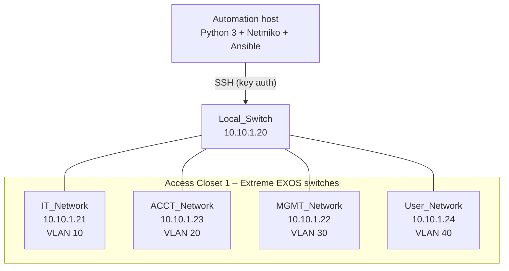
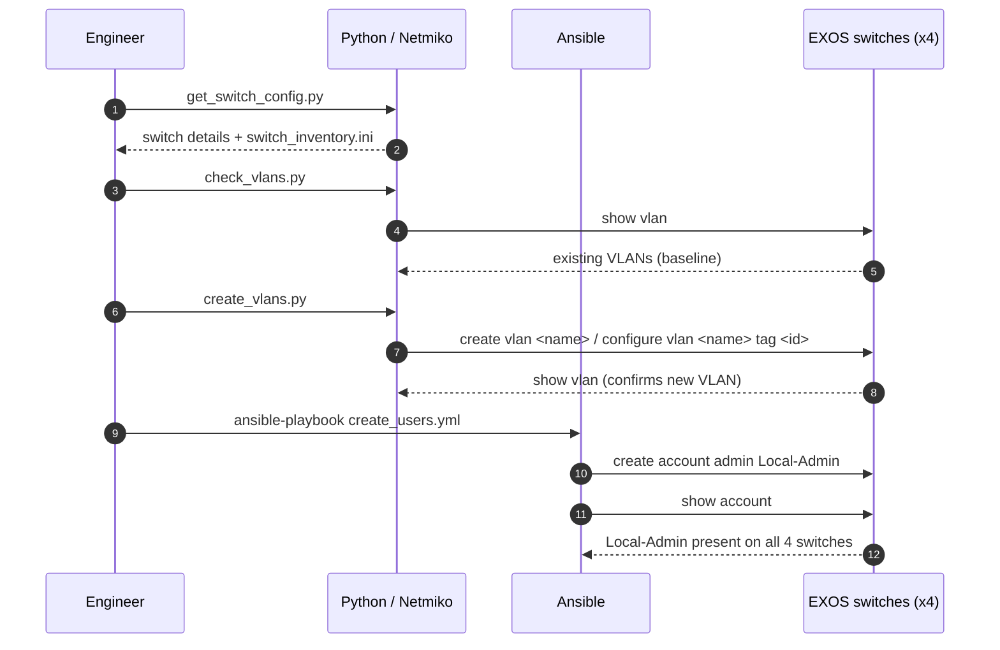
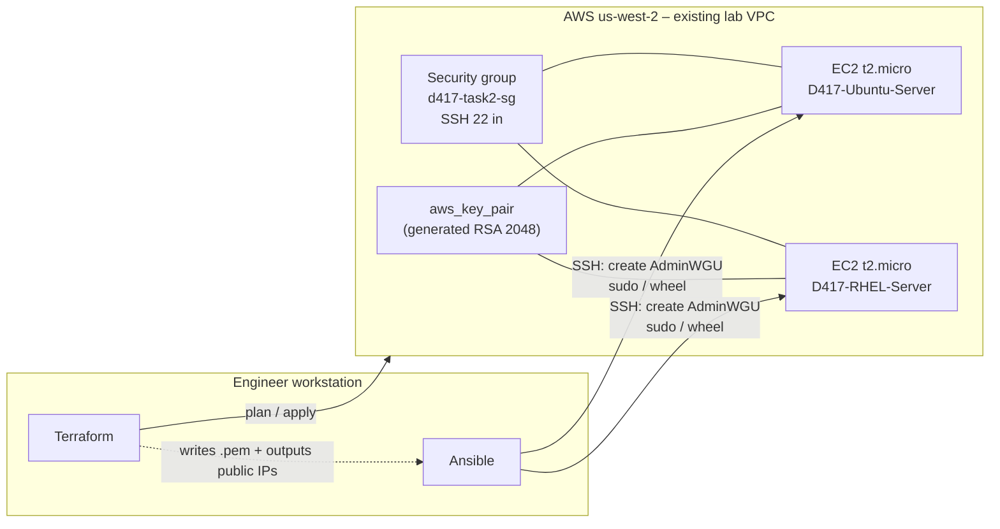
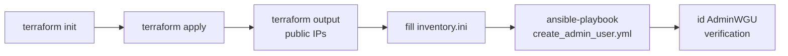

# Network Automation & Cloud Provisioning (Python · Ansible · Terraform)

Automating a multi-VLAN campus switch network with **Python/Netmiko** and **Ansible**, then provisioning and configuring a mixed Ubuntu/RHEL server fleet on **AWS** with **Terraform** and **Ansible**.

> Built for **WGU D417 – Network Automation and Deployment** (B.S. Cloud & Network Engineering). The scenario: a network engineer at an IT vendor that supports school districts replaces manual, box-by-box configuration with repeatable automation.


---

## Project scope

### Problem
Configuring VLANs and local admin accounts one device at a time is slow, error-prone and hard to audit. The same goes for standing up servers by hand in the cloud.

### Objectives
| # | Objective | Delivered by |
|---|-----------|--------------|
| 1 | Inventory every access switch and generate an Ansible inventory | `get_switch_config.py` |
| 2 | Audit the VLANs on all switches | `check_vlans.py` |
| 3 | Create a department VLAN on each switch (IT 10, ACCT 20, MGMT 30, User 40) | `create_vlans.py` |
| 4 | Create a read/write `Local-Admin` account on every switch | `create_users.yml` |
| 5 | Provision one Ubuntu and one RHEL server on AWS from code | Terraform (`task2-cloud-provisioning/terraform`) |
| 6 | Create a privileged `AdminWGU` account on both OS families from one playbook | `create_admin_user.yml` |

### In scope
- SSH key-based automation against four Extreme Networks EXOS switches
- Idempotent account creation with Ansible (`extreme.exos` collection and the `user` module)
- Infrastructure as Code for EC2, a security group and a generated key pair
- OS-aware configuration: `sudo` on Debian/Ubuntu, `wheel` on RHEL

### Out of scope
- Inter-VLAN routing and trunk design (handled by the lab's core/local switch)
- Remote Terraform state, CI/CD pipelines, secrets management beyond runtime prompts

---

## Task 1 – Campus switch automation

### Topology



### Automation workflow



### VLAN plan

| Switch | Mgmt IP | VLAN name | VLAN ID |
|--------|---------|-----------|---------|
| IT_Network | 10.10.1.21 | IT_Network | 10 |
| ACCT_Network | 10.10.1.23 | ACCT_Network | 20 |
| MGMT_Network | 10.10.1.22 | MGMT_Network | 30 |
| User_Network | 10.10.1.24 | User_Network | 40 |

---

## Task 2 – Cloud server provisioning

### Architecture



### Pipeline



Terraform resources: `tls_private_key`, `aws_key_pair`, `local_file` (private key, mode 0400), `aws_security_group`, two `aws_instance`, plus data sources that look up the existing lab VPC and subnets by tag.

---

## Repository structure

```
.
├── requirements.txt
├── task1-switch-automation/
│   ├── scripts/            # Netmiko scripts: inventory, VLAN audit, VLAN creation
│   ├── ansible/            # Inventories + Local-Admin playbook (EXOS)
│   └── outputs/            # Captured run output from the lab
└── task2-cloud-provisioning/
    ├── terraform/          # provider, key pair, security group, Ubuntu + RHEL EC2, outputs
    ├── ansible/            # Cross-distro admin-user playbook + example inventory
    └── outputs/            # terraform apply / ansible run output
```

## Running it

```bash
pip install -r requirements.txt
ansible-galaxy collection install extreme.exos
```

**Task 1** (needs SSH reachability to the switches):
```bash
cd task1-switch-automation/scripts
python3 get_switch_config.py
python3 check_vlans.py
python3 create_vlans.py
cd ../ansible
ansible-playbook -i inventory.ini create_users.yml   # prompts for the Local-Admin password
```

**Task 2** (needs AWS credentials in your environment):
```bash
cd task2-cloud-provisioning/terraform
terraform init && terraform apply
terraform output
cd ../ansible
cp inventory.example.ini inventory.ini     # paste the IPs from terraform output
ADMIN_PASSWORD='choose-one' ansible-playbook -i inventory.ini create_admin_user.yml
terraform -chdir=../terraform destroy      # clean up when done
```

## Results

- 4/4 switches inventoried and audited, with the correct VLAN created and tagged on each one ([outputs](task1-switch-automation/outputs))
- `Local-Admin` created and verified on all switches with one playbook run
- Ubuntu and RHEL servers built from code in a single `terraform apply`
- One playbook handled both OS families by choosing the admin group from `ansible_facts['os_family']` ([output](task2-cloud-provisioning/outputs/ansible_output.txt))

## What I'd improve next

- Move the switch list into a YAML or inventory file shared by the Python scripts and Ansible, so it lives in one place
- Make `create_vlans.py` idempotent (skip if the VLAN already exists) and add `--dry-run`
- Use Ansible Vault for credentials and restrict the security group's SSH rule to a known CIDR, not `0.0.0.0/0`
- Store Terraform state remotely (S3 + DynamoDB lock) and add `terraform fmt`/`validate`/`tflint` in CI

---

<sub>Academic project completed at Western Governors University. Lab IPs are from a disposable training environment, and passwords have been removed from the code and captured output.</sub>
